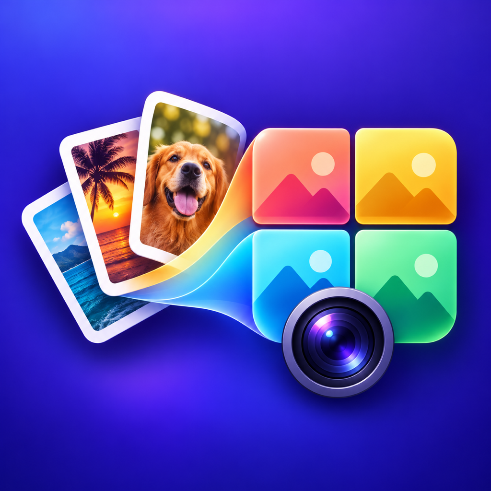
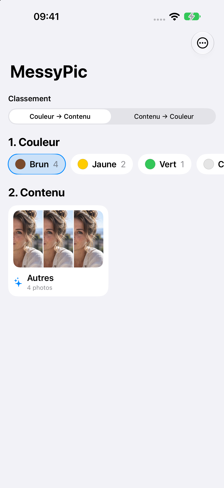
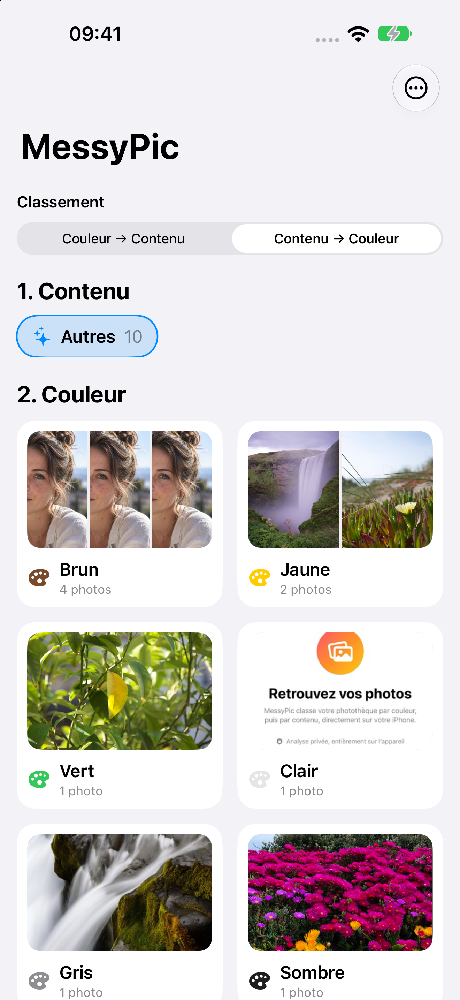

# MessyPic

[Français](#français) · [English](#english)

## Français

MessyPic est une application iPhone pour retrouver ses photos par **couleur** et par **contenu**, grâce à une analyse locale avec Apple Vision. Elle crée un index de la photothèque, sans déplacer ni modifier les originaux.

### Aperçu

 

Les deux modes : **Couleur → Contenu** et **Contenu → Couleur**. Captures du simulateur ; l’interface actuelle est en français. La reconnaissance de contenu peut être limitée dans le simulateur.

### Fonctionnalités

- Choisir l’ordre de classement ; ce choix est mémorisé.
- Parcourir les catégories les plus utilisées en premier, puis les photos les plus récentes dans chaque groupe.
- Couleurs : Rouge, Orange, Jaune, Vert, Turquoise, Bleu, Violet, Rose, Brun, Clair, Gris et Sombre.
- Contenus : Personnes, Animaux, Nourriture, Nature, Ciel étoilé, Transport, Documents, Architecture, Objets et Autres.
- Consulter la photo, sa date, sa catégorie et une palette de cinq couleurs au maximum avec leurs proportions.
- Déplier les résultats de Vision : jusqu’à huit étiquettes et leurs scores de confiance, affichés en petits caractères.
- Ouvrir une image dans une autre application ou la partager via la feuille de partage d’iOS, selon les applications installées.
- Autoriser toute la photothèque ou une sélection de photos ; actualiser l’index ou relancer l’analyse depuis le menu.

### Choix de la couleur

Pour les personnes, animaux, aliments, transports et objets, MessyPic tente de détecter le sujet au premier plan avec Vision. Si un masque exploitable est disponible, le classement utilise les couleurs du sujet plutôt que celles du fond. Les couleurs saturées sont davantage pondérées pour éviter, par exemple, qu’un vêtement jaune soit masqué par des tons de peau beige. Un sujet très majoritairement neutre peut toutefois rester classé Clair, Gris ou Sombre.

Les pourcentages affichés restent des proportions de surface estimées, sans cette pondération. La couleur de classement n’est donc pas nécessairement celle qui occupe le plus de pixels. La palette de toute la photo reste accessible dans une section pliable lorsque le sujet a été détecté.

Pour les autres catégories, ou si la détection du sujet échoue, l’analyse utilise toute la photo. **Ciel étoilé** repose sur l’étiquette `night_sky` de Vision et peut aussi inclure un ciel nocturne sans étoiles clairement visibles. Le classement reste une estimation et peut se tromper.

### Confidentialité

L’analyse des couleurs et du contenu est réalisée sur l’appareil ; ses résultats sont conservés dans un cache local. MessyPic n’envoie pas les photos à un serveur d’analyse. Photos peut toutefois télécharger un original depuis iCloud si nécessaire. Le partage avec une autre application n’a lieu qu’à votre demande.

### Développement et lancement

Le projet cible actuellement **iOS 27.0 minimum** et nécessite **Xcode 27 avec le SDK iOS 27**. Il utilise SwiftUI, Photos, Vision et Core Image, sans dépendance tierce.

1. Ouvrir `MessyPic.xcodeproj` dans Xcode.
2. Sélectionner le schéma partagé `MessyPic` et un iPhone ou un simulateur compatible.
3. Pour un iPhone physique, choisir sa propre équipe dans **Signing & Capabilities** et, si nécessaire, un identifiant de bundle unique.
4. Lancer avec **Run**, puis autoriser l’accès aux photos.

Un iPhone physique est recommandé pour vérifier la classification Vision et la détection du sujet. L’analyse initiale dépend du nombre de photos et de leur disponibilité ; les groupes apparaissent progressivement. Les résultats sont mis en cache et les anciennes versions de l’index sont automatiquement réanalysées.

### Archives et numéro de build

Le schéma partagé lance `xcrun agvtool next-version -all` **après chaque archive**, afin de préparer le numéro de build suivant dans le projet. L’archive produite conserve le numéro utilisé lors de sa création. L’incrémentation est liée à l’archive, pas au transfert effectif vers App Store Connect ; transférer à nouveau la même archive ne change pas son numéro.

### Vérifications

Les tests de régression se lancent sur macOS avec Xcode installé. Commandes et cas couverts : [Tests/README.md](Tests/README.md#français).

## English

MessyPic is an iPhone app for finding photos by **color** and **content**, using local analysis with Apple Vision. It indexes your photo library without moving or modifying the originals.

### Preview

 

The two modes: **Color → Content** and **Content → Color**. Simulator screenshots; the current app interface is in French. Content recognition may be limited in the simulator.

### Features

- Choose the grouping order; your preference is saved.
- Browse the most populated categories first, then the newest photos within each group.
- Colors: Red, Orange, Yellow, Green, Turquoise, Blue, Purple, Pink, Brown, Light, Gray and Dark.
- Content: People, Animals, Food, Nature, Starry sky, Transport, Documents, Architecture, Objects and Other.
- View each photo, its date, its category and a palette of up to five colors with their proportions.
- Expand the Vision results to see up to eight labels and their confidence scores in small text.
- Open an image in another app or share it through the iOS share sheet, depending on the installed apps.
- Grant access to the whole library or selected photos; refresh the index or rerun analysis from the menu.

### Color selection

For people, animals, food, transport and objects, MessyPic attempts to detect the foreground subject with Vision. When a usable mask is available, grouping uses the subject’s colors rather than the background. Saturated colors receive more weight, helping a yellow garment stand out against muted beige skin tones, for example. A predominantly neutral subject can still be classified as Light, Gray or Dark.

The displayed percentages remain estimated area proportions, without this weighting. The grouping color is therefore not necessarily the color covering the most pixels. When a subject is detected, the whole-photo palette remains available in a collapsible section.

Other categories, or photos where subject detection fails, use the whole image. **Starry sky** relies on Vision’s `night_sky` label and may also include night-sky photos without clearly visible stars. Classification is an estimate and can be incorrect.

### Privacy

Color and content analysis run on the device, with results stored in a local cache. MessyPic does not upload photos to an analysis server. Photos may download an original from iCloud when needed. Sharing with another app happens only at your request.

### Development and running the app

The project currently targets **iOS 27.0 or later** and requires **Xcode 27 with the iOS 27 SDK**. It uses SwiftUI, Photos, Vision and Core Image, with no third-party dependencies.

1. Open `MessyPic.xcodeproj` in Xcode.
2. Select the shared `MessyPic` scheme and a compatible iPhone or simulator.
3. For a physical iPhone, select your own team in **Signing & Capabilities** and, if needed, a unique bundle identifier.
4. Run the app, then grant photo-library access.

A physical iPhone is recommended for validating Vision classification and subject detection. Initial analysis time depends on the number and availability of photos; groups appear progressively. Results are cached, and outdated index entries are automatically reanalyzed.

### Archives and build numbers

The shared scheme runs `xcrun agvtool next-version -all` **after each archive** to prepare the next build number in the project. The completed archive retains the number used when it was created. Incrementing is tied to archiving, not to the actual upload to App Store Connect; uploading the same archive again does not change its build number.

### Checks

Regression checks run on macOS with Xcode installed. Commands and coverage: [Tests/README.md](Tests/README.md#english).
